

  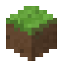

<h1 align="center">BlockCraft DS</h1>

  A Minecraft-inspired block building and survival game for the Nintendo DS and DSi, 
  written from scratch in C with original procedural art and sound.

  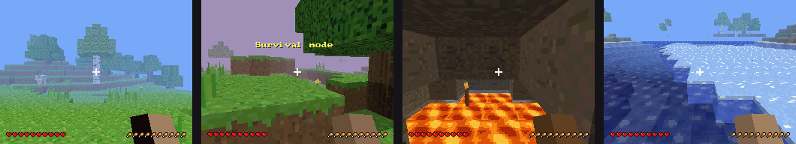

> Fan-made homebrew. Not affiliated with or endorsed by Mojang or Microsoft.
> All textures, sounds and music are generated from code in this repository.

## Features

- **Survival and Creative modes**: health, hunger, air, fall damage and armor in Survival; unlimited blocks and flying in Creative
- **Procedural worlds**: plains, forests, deserts, snowy areas, mountains, oceans and beaches, with caves, lava lakes and ores
- **Crafting**: about 100 recipes on a 2×2 or 3×3 grid, plus furnace smelting and chests
- **Tools and armor** from wood up to diamond, with mining speeds and durability
- **Mobs**: pigs, cows, sheep and chickens; zombies, skeletons (with bows), spiders, and the explosive *Boomshroom*
- **A living world**: day/night cycle, flowing water and lava, falling sand and gravel, leaf decay, growing crops and saplings, fire, TNT
- **Farming, beds, doors, ladders, torches** and more
- **Easy crafting**: a recipe list shows everything you can make; pick one and press A, no grid arranging needed
- **Touch-screen inventory**, hotbar and menus on the bottom screen, all of which also work with the buttons
- **Saves** to the SD card, with 3 world slots
- Sound effects and generative background music

| | | |
|:-:|:-:|:-:|
| 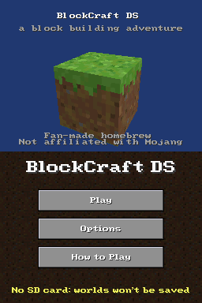 | 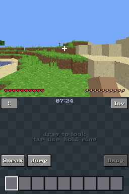 | 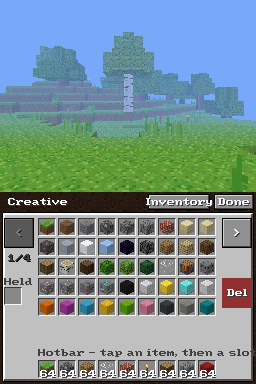 |
| Title screen | Desert biome | Creative inventory |
| 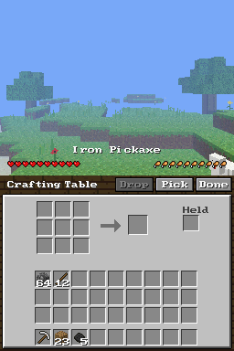 | 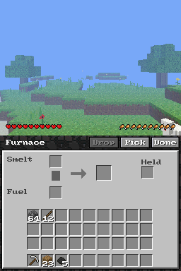 | 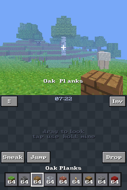 |
| Crafting table | Furnace | Building |
| 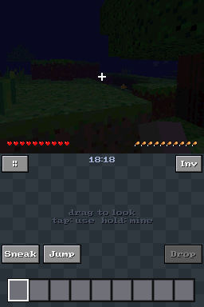 | 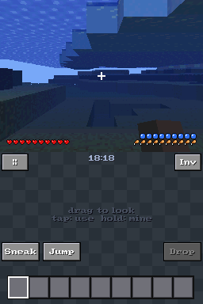 | 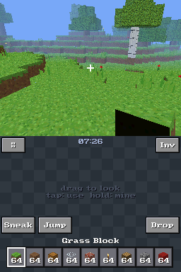 |
| Night | Underwater | Flying in Creative |

## Playing it

You need a DS or DSi that can run homebrew (for example a DSi with
[TWiLight Menu++](https://github.com/DS-Homebrew/TWiLightMenu)), or an emulator such as melonDS.

1. Download [`release/blockcraft.nds`](release/blockcraft.nds) (or grab it from the Releases page).
2. Copy it to your SD card.
3. Launch **BlockCraft DS** from TWiLight Menu++.

Worlds are saved in `sd:/blockcraft/`. On a DSi the game runs in DSi mode, which gives it more
memory, a faster CPU and the option of a larger 256×256 world.

### Controls

| Input | Action |
|---|---|
| D-pad | Move (double-tap Up to sprint) |
| A / Y | Turn right / left |
| X / B | Look up / down |
| Stylus drag (bottom screen) | Look around |
| R (tap) | Place / use / attack / eat |
| R (hold) | Mine |
| L | Jump (double-tap in Creative to fly) |
| SELECT (tap / hold) | Next hotbar slot / sneak |
| START | Pause, save and quit |

L and R can be swapped in Options, along with look speed, render distance, volume and other settings.

### Crafting and inventory

Open the inventory (or use a crafting table) and you land on the **Craft** tab: a list of recipes,
with the ones you can make right now at the top.

| Input | Craft tab | Items tab |
|---|---|---|
| D-pad | Choose a recipe (Left/Right page) | Move the cursor between slots |
| A | Craft one | Pick up / put down |
| X | Craft as many as possible | Take half a stack |
| Y | | Quick-move (hotbar ↔ inventory, into chests and furnaces) |
| L / R | Switch to Items | Switch to Craft |
| B | Close | Close |

You can also tap a recipe to select it and tap it again to craft. Recipes bigger than 2×2 need a
crafting table. The classic grid is still on the Items tab.

## Building from source

1. Install the [BlocksDS](https://blocksds.skylyrac.net/) SDK and make sure `BLOCKSDS` points to it.
2. Run `make` in the repository root. This produces `blockcraft.nds`.

`make -f Makefile.test` builds a self-test ROM that creates a fixed world and checks mining times,
drops, crafting, smelting, liquids, gravity, saplings, eating, fall damage, mobs, armor, TNT and the
save format, then shows the results on the bottom screen.

The art and sound data in `data/` are generated by `tools/gen_assets.py` (Python 3 + Pillow);
the ROM icon comes from `tools/make_icon.py`. The generated files are committed, so you only need
to rerun these if you change the assets.

## How it works

The DS has a 67 MHz ARM9 (133 MHz on DSi), 4 MB of RAM (16 MB on DSi) and a 3D chip that draws at
most 2048 polygons per frame, so a lot of the engine is about fitting a voxel world into that:

- The world is stored as 16×16×16 sections. Each one is turned into hardware display lists with
  **greedy meshing**, which merges neighboring faces with the same texture and light into one quad.
- Faces are found with **column bitmasks** so solid rock and empty sky are skipped 16 blocks at a time.
- A **visibility flood fill** between sections skips whatever is hidden behind terrain, and a
  **polygon budget** draws sections near to far, hiding the cut-off point in fog.
- Display-list memory has its own budget, and sections that haven't been drawn lately are freed and
  rebuilt on demand.
- Sky light and block light (torches, lava, jack-o'-lanterns) spread with flood fills and are
  applied through the DS's hardware lighting.

Source overview:

| File | Purpose |
|---|---|
| `source/worldgen.c`, `noise.c` | Terrain, biomes, caves, ores and trees |
| `source/world.c` | Block storage and lighting |
| `source/mesh.c`, `render.c` | Meshing, visibility and drawing |
| `source/player.c`, `physics.c` | Movement, collision, mining and building |
| `source/sim.c` | Liquids, gravity, crops, fire and other block updates |
| `source/entity.c` | Mobs, items, arrows, TNT and particles |
| `source/inventory.c` | Recipes, chests and furnaces |
| `source/ui.c`, `hud.c` | Touch-screen menus and top-screen HUD |
| `source/save.c` | SD card saving |

## License

MIT. See [LICENSE](LICENSE).
